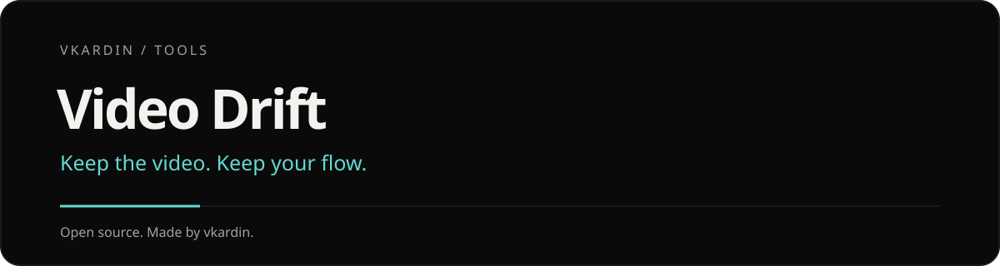

<h1 align="center">Video Drift</h1>

<b>Плаваючий відеоплеєр, який пам'ятає, де ви зупинилися</b> 
<a href="README.md">English</a> · <a href="README.ru.md">Русский</a> · Українська

Video Drift виносить будь-яке веб-відео у плаваюче вікно поверх інших, поки ви працюєте. Субтитри сайту переїжджають разом із ним, точна секунда зупинки запам'ятовується для кожного відео, а нотатки до кадру вивантажуються в охайний Markdown. Працює на YouTube, Twitch, онлайн-курсах і будь-якому іншому сайті з HTML5-відео. Безкоштовно, без акаунта.

## Версія 2.0

Окрема бібліотека: «Продовжити», «Подивитися пізніше», закладки, пошук і фільтр сайтів. Копія JSON об’єднується з наявними даними; видалення в бібліотеці можна скасувати. Мініплеєр запам’ятовує розмір і положення. Додаткові кнопки згортаються; A–B задає початок, кінець і вимикає повтор третім натисканням. У налаштуваннях доступні розмір, тло і відступ субтитрів. Вибір відео працює в поточному фреймі. Дані 1.x зберігаються.

## Встановлення

- **Chrome, Edge, Brave, Opera:** сторінка в Chrome Web Store незабаром з'явиться, поки що ставте zip нижче
- **Firefox:** сторінка в Firefox Add-ons незабаром з'явиться, поки що ставте zip нижче
- **Вручну:** zip для Chrome і Firefox на сторінці [Releases](../../releases). Chrome: розпакуйте, відкрийте `chrome://extensions`, увімкніть режим розробника, натисніть «Завантажити розпаковане». Firefox: `about:debugging` → «Завантажити тимчасовий додаток»

## Можливості

- Плаваюче вікно з власними кнопками (Document Picture-in-Picture), нативний PiP як запасний варіант або міні-плеєр поверх сторінки
- Субтитри сайту (YouTube, Netflix, Video.js, Plyr, JW Player та інші) залишаються з відео
- Запам'ятовує позицію кожного відео й пропонує «Продовжити з 12:34?»
- Закладки з нотатками до кадру; експорт одного відео або всього одразу в Markdown для Obsidian чи Notion
- Посилання, що відкриває відео на поточній секунді
- Смуга перемотування, швидкість 0.25×–4×, пресети гучності й гарячі клавіші просто в плеєрі
- Режим тіні: прозорість 30–100% для міні-плеєра поверх сторінки
- Вибір кнопок плеєра; English, Русский, Українська; світлий і темний попап

### Бібліотека перегляду (1.4)

- **Продовжити**: останні недодивлені відео з прогресом і переходом до збереженого моменту. Історія зберігається на пристрої: можна видалити відео, очистити список або вимкнути збереження в налаштуваннях.
- **Закладки**: спільна колекція з пошуком за відео, сайтом і нотатками, редагуванням нотаток та експортом Markdown. Доступна навіть на вкладці без відео.

### Гарячі клавіші

| Дія | Клавіші |
|---|---|
| Винести відео / повернути | <kbd>Alt</kbd>+<kbd>Shift</kbd>+<kbd>P</kbd> на сторінці |
| Швидше / повільніше | <kbd>Alt</kbd>+<kbd>Shift</kbd>+<kbd>.</kbd> / <kbd>Alt</kbd>+<kbd>Shift</kbd>+<kbd>,</kbd> |
| Закладка на поточний момент | <kbd>Alt</kbd>+<kbd>Shift</kbd>+<kbd>B</kbd> |
| У плаваючому вікні | <kbd>Пробіл</kbd>, <kbd>←</kbd>/<kbd>→</kbd> ±5 с, <kbd>&lt;</kbd>/<kbd>&gt;</kbd> швидкість |

## Приватність

Video Drift не збирає даних і нічого нікуди не надсилає: усе працює на вашому пристрої. [Політика конфіденційності](https://vkardin.github.io/video-drift/privacy.html).

## Зворотний зв'язок і підтримка

- Ідеї та помилки: [сторінка зворотного зв'язку](https://vkardin.github.io/video-drift/support.html) або [GitHub Issues](../../issues/new/choose)
- Підтримати проєкт криптовалютою: [https://vkardin.github.io/video-drift/#donate](https://vkardin.github.io/video-drift/#donate)

## Репозиторій

| Тека | Що всередині |
|---|---|
| [`extension/`](extension) | Вихідний код розширення (завантаження через `chrome://extensions` → режим розробника → «Завантажити розпаковане») |
| [`docs/`](docs) | Сайт на GitHub Pages |
| [`store/`](store) | Тексти для магазинів і специфікація графіки |
| [`tools/`](tools) | `build.py` збирає zip для Chrome і Firefox |

## Ліцензія

[MIT](LICENSE) © vkardin

<!-- project-family:start -->
## Інші інструменти від vkardin

| Project | Проєкти |
| --- | --- |
| **[Video Glow](https://vkardin.github.io/video-glow/)** | Підсвічування навколо відео в колір кадру. М’яке світло, LED-стрічка й колір кімнати. [GitHub](https://github.com/vkardin/video-glow) |
| **[Leveler](https://vkardin.github.io/leveler/)** | Рівна гучність, розбірливі діалоги, еквалайзер і керування швидкістю. [GitHub](https://github.com/vkardin/leveler) |
| **[Snapt](https://vkardin.github.io/snapt/)** | Знімки екрана, стрілки й підписи. Застосунок для Windows, macOS та Linux і розширення браузера. [GitHub](https://github.com/vkardin/snapt) |
| **[UNI](https://vkardin.github.io/uni-homebot/)** | Домашній сервер у Telegram: застосунки, моніторинг, сповіщення й мінізастосунок. [GitHub](https://github.com/vkardin/uni-homebot) |

[github.com/vkardin](https://github.com/vkardin) · Незалежні інструменти · відкритий код
<!-- project-family:end -->
